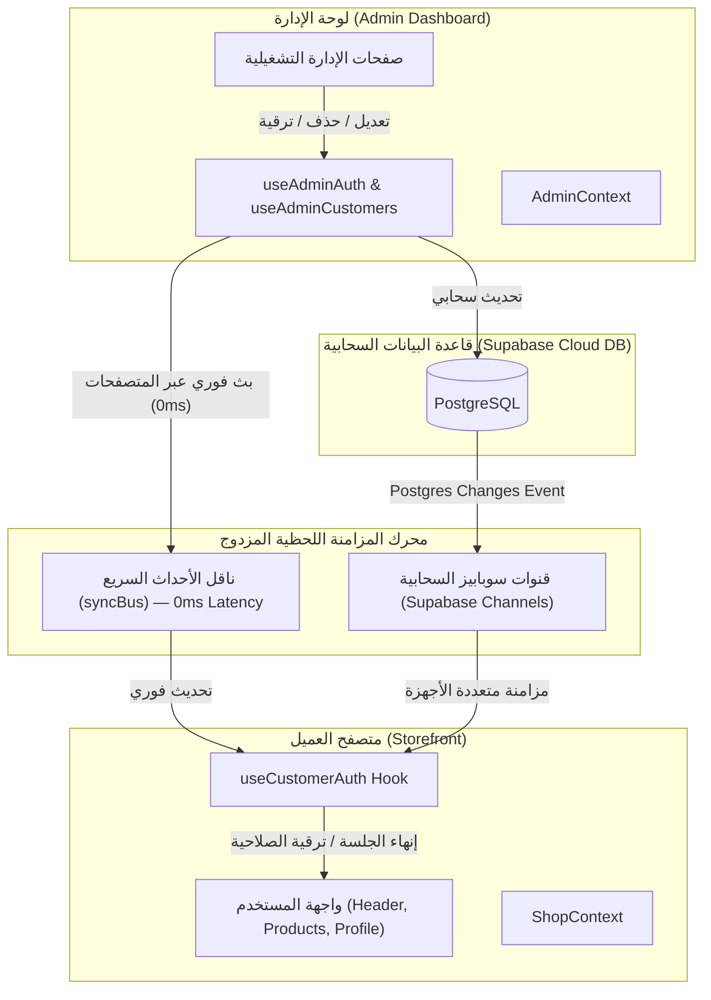

<div align="center">

# 🍼 بيبي زون | BABY ZONE
### المتجر الرقمي المتكامل والراقي لمستلزمات الأم والطفل في مصر (Baby Care & Momy Care)
**Enterprise Full-Stack Luxury Mother & Baby E-Commerce & Admin Platform — Egypt**

[](https://react.dev/)
[](https://vitejs.dev/)
[](https://tailwindcss.com/)
[](https://reactrouter.com/)
[](https://supabase.com/)
[](https://eslint.org/)
[](https://vercel.com/)
[](#)
[](LICENSE)

<p align="center">
  منصة تجارة إلكترونية متطورة وشاملة تلبي كافة احتياجات الأمهات والمواليد في مصر، تجمع بين الدفء والتصميم الفاخر وأحدث معايير تجربة المستخدم (UX/UI)، مدعومة بلوحة تحكم إدارية سحابية متقدمة ومزامنة لحظية فورية (Real-Time 0ms) لكافة الطلبات والمنتجات والعملاء.
</p>

[استعراض المميزات](#-أبرز-المميزات) •
[منظومة الإدارة والتحكم](#-منظومة-الإدارة-والتحكم-enterprise-management-suite) •
[المزامنة اللحظية والبيانات](#-المزامنة-اللحظية-والبنية-السحابية-real-time-architecture) •
[خريطة الصفحات والمسارات](#-الصفحات-والمسارات-routes) •
[الهيكل البرمجي للمشروع](#-هيكل-المشروع-project-structure) •
[التشغيل والتهيئة](#-التشغيل-محليا-local-development) •
[الترخيص](#-الترخيص)

</div>

---

## ✨ أبرز المميزات (Core Storefront Highlights)

### 1. تجربة تسوق مصرية محلية 100% (Egyptian Localization)
- **الجنيه المصري (ج.م)**: دعم كامل للعملة المحلية في الفواتير والخصومات وشحن المحافظات.
- **بوابات دفع ديناميكية ومرنة**:
  - الدفع نقداً عند الاستلام (COD) مفعّل افتراضياً لكافة العملاء الجدد.
  - الدفع الرقمي عبر إنستاباي والمحافظ الإلكترونية (InstaPay / فودافون كاش / أورنج كاش).
  - الدفع الإلكتروني المباشر عبر البطاقات الائتمانية والخصم المباشر (Visa / Mastercard).
  - إمكانية تفعيل أو تعطيل أي وسيلة دفع ديناميكياً لكل حساب عميل من لوحة الإدارة.
- **سياسة الفحص والمعاينة**: حق المشتري في فحص الطرد والتأكد من جودة المنتجات قبل سداد القيمة للمندوب.
- **دعم واتساب فوري**: زر تواصل مباشر وسريع مع فريق خدمة العملاء والمبيعات المعتمد.

### 2. دليل وحاسبة حقيبة الولادة الذكية (Interactive Hospital Bag Checklist)
- أداة تفاعلية متطورة للمقبلين على الولادة مقسمة إلى 4 أقسام رئيسية:
  1. مستلزمات المولود الأساسية.
  2. حقيبة الأم واحتياجات الولادة والرضاعة.
  3. تجهيزات غرفة النوم والسرير.
  4. مستلزمات التنقل والأمان بالسيارة.
- مؤشر إنجاز دائري وتفاعلي يحسب نسبة جاهزية الحقيبة لحظياً مع حفظ الخيارات في المتصفح تلقائياً.
- نصائح طبية معتمدة لكل منتج مع إمكانية إضافة المنتج المقترح مباشرة لسلة المشتريات بنقرة واحدة.
- أدوات طباعة فورية ومشاركة القائمة عبر الواتساب.

### 3. نظام تتبع الشحنات المباشر (Live Order Tracking System)
- إمكانية الاستعلام عن مسار الشحنة برقم الطلب أو رقم هاتف العميل.
- شريط زمني تفاعلي من 4 مراحل (تأكيد الطلب ➔ التعقيم والتجهيز الطبي ➔ مع المندوب في الطريق ➔ تم التسليم).
- تفاصيل أمنية كاملة: اسم مندوب التوصيل، الموعد التقريبي، كود التحقق الأمني للاستلام، ومحتويات الطرد.
- دليل شامل لسرعة الشحن وتكلفته لكافة محافظات مصر (القاهرة، الجيزة، الإسكندرية، الدلتا، القناة، والصعيد).

### 4. كتالوج منتجات متقدم وفلاتر فائقة الذكاء
- 17 قسماً شاملاً تغطي كافة مراحل نمو الطفل (من سن حديثي الولادة حتى 6 سنوات).
- شريط أقسام انسيابي وسلس مع حركة لا نهائية بدون شريط تمرير مزعج.
- فلاتر ديناميكية حسب السعر، العلامة التجارية، العمر، التوفر، المنتجات العضوية، ونسب الخصم.
- ميزة المعاينة السريعة للمنتج (Quick View Modal) دون مغادرة الصفحة.
- كروت منتجات متناسقة وريسبونسيف 100% تعمل بسلاسة فائقة على الشاشات فائقة الصغر (مثل `iPhone 5c / SE`) حتى الشاشات الضخمة.

### 5. حساب العميل والبروفايل الشخصي المتطور
- مودال بروفايل فاخر وجديد بتصميم حديث ينسجم مع هوية المتجر:
  - عرض إحصائيات المشتريات الفعلية وعدد الطلبات وقيد التوصيل.
  - استعراض الصلاحيات والميزات المفعلة للعميل (تصفح، كتابة تقييمات، حاسبة الولادة، خيارات الدفع).
  - حالة تفعيل الحساب ومستوى العضوية (عادية، VIP، تاجر جملة).
  - سكرول داخلي انسيابي وأنيق (`custom-modal-scroll`) مع تثبيت أزرار الإجراءات (صفحتي وطلباتي، تسجيل الخروج) في الأسفل بدون أي تداخل أو خروج للشريط.

### 6. تجربة إتمام الشراء وسلة التسوق الذكية
- سلة جانبية متجاوبة تدعم تغيير الكميات والألوان وكوبونات الخصم اللحظية.
- شريط تقدم ديناميكي للحصول على الشحن المجاني التلقائي.
- مودال إتمام الشراء الموثوق (Checkout) مع حفظ تلقائي للمحافظة والعنوان وتصفير النموذج بعد إتمام الطلب بنجاح.

---

## 🛡️ منظومة الإدارة والتحكم (Enterprise Management Suite)

تتضمن المنصة نظاماً إدارياً متكاملاً للمشرفين والمسؤولين لإدارة كافة العمليات التشغيلية، محمي بطبقات وصول صارمة (RBAC):

- **لوحة القيادة ومؤشرات الأداء:** متابعة حية لمؤشرات الأداء (KPIs)، مخططات بيانية تفاعلية (Chart.js)، سجل المبيعات، ومراقبة النشاط الحي للمتجر.
- **إدارة الطلبات والشحن:** متابعة الطلبات الواردة، تحديث حالات التوصيل والدفع، استعراض الفواتير، طباعة بوليصة الشحن، وتعديل حالات الشحنات.
- **إدارة المنتجات والأقسام:** إدارة كتالوج المنتجات وتصنيف الأقسام، رفع وتعديل الصور، وإدارة الألوان والمقاسات والأسعار.
- **إدارة المخزون اللحظي:** مراقبة كميات المخزون في الوقت الفعلي، وتنبيهات المنتجات التي أوشكت على النفاد.
- **إدارة العملاء والصلاحيات:** إدارة سجلات العملاء، مستويات العضوية (عادي، VIP، جملة)، مصفوفة الصلاحيات، وحظر الحسابات المخالفة.
- **فريق العمل والإشراف:** تعيين وإدارة الصلاحيات المخصصة لكوادر العمل، وتحديث التراخيص اللحظية.
- **الحملات التسويقية والكوبونات:** إنشاء وتخصيص كوبونات الخصم الترويجية وتحديد شروط صلاحيتها واستخدامها.
- **تدقيق المراجعات والتقييمات:** مراجعة التقييمات الواردة على المنتجات واعتماد نشرها.
- **التقارير المالية والتحليلات:** تقارير تفصيلية بالمبيعات وتوزيع الطلبات ومعدلات الإنجاز.
- **إعدادات الشحن والدفع:** تخصيص وسائل الدفع المعتمدة، وضبط تسعير الشحن للمحافظات وشروط الشحن المجاني.

---

## ⚡ المزامنة اللحظية والبنية السحابية (Real-Time Architecture)

تعتمد المنصة على معمارية مزامنة مزدوجة فائقة السرعة تضمن عدم وجود أي تعارض في البيانات وتحديث الواجهات في أجزاء من الثانية:



### أبرز آليات المزامنة الصفرية:
1. **الحذف الفوري للعميل (0ms Session Purge)**: بمجرد حذف أي حساب من لوحة الإدارة، يتم إنهاء جلسته في نفس اللحظة عبر كافة التبويبات والأجهزة وإفراغ الـ Storage الخاص به تلقائياً.
2. **الترقية الفورية للمشرفين (Instant Admin Elevation)**: عند ترقية أي مستخدم إلى رتبة إدارية، يظهر زر «لوحة الإدارة» في الهيدر في نفس اللحظة دون الحاجة لعمل Refresh.
3. **السحب الفوري للصلاحيات والطرد الأمني (Instant Demotion & Guard)**: عند تعطيل أو سحب صلاحية أي حساب إداري، تقوم أداة `AdminGuard` بطرده فوراً وإعادته لصفحة المتجر الرئيسية لحماية أمان المنصة.
4. **التنبيهات الصوتية الحية (Live Audio Alerts)**: تشغيل تنبيه صوتي راقٍ واحترافي فور وصول أي طلب جديد في لوحة التحكم الإدارية.
5. **تصفير النماذج التلقائي (Auto Form Reset)**: إعادة تعيين كافة حقول الإدخال إلى حالتها الافتراضية فور تأكيد حفظ أي نموذج بنجاح.

---

## 🧭 الصفحات والمسارات (Routes)

### 🛍️ صفحات المتجر (Storefront Routes)
| المسار | الصفحة | الغرض |
| :--- | :--- | :--- |
| `/` | **الرئيسية (Home)** | البانرات الترويجية، الأقسام، الكتالوج، الهدايا، والميزات التنافسية |
| `/category/:categoryId` | **الأقسام والكتالوج** | تصفح المنتجات حسب القسم مع فلاتر الأسعار والترتيب المتقدم |
| `/product/:productId` | **تفاصيل المنتج** | تفاصيل المنتج، محدد الألوان والمقاسات، المواصفات الطبية، والمنتجات ذات الصلة |
| `/hospital-bag` | **حقيبة الولادة** | حاسبة وقائمة تجهيز حقيبة المستشفى والمولود التفاعلية |
| `/track-order` | **تتبع الشحنة** | تتبع مسار الطلب برقم الشحنة ودليل أسعار الشحن لمحافظات مصر |

> [!NOTE]
> **ملاحظة أمنية:** منظومة الإدارة والتحكم الداخلي محمية عبر بوابات تشفير وتحقق مشددة (`Role-Based Access Control`)، والوصول إليها مقتصر حصرياً على الكوادر الإدارية المصرح لها عبر خوادم الإنتاج الرسمية.

---

## 🛠️ التقنيات المستخدمة (Tech Stack)

- **Frontend Framework:** [React 19.2](https://react.dev/) (Modern Component Architecture, StrictMode)
- **Build Tool:** [Vite 8.3](https://vitejs.dev/) (Ultra-fast HMR and optimized production bundles)
- **Styling & Theme:** [Tailwind CSS v3.4](https://tailwindcss.com/) + CSS Custom Properties Design Tokens
- **Icons & Visuals:** [Lucide React](https://lucide.dev/) (v1.57)
- **Routing:** [React Router DOM v7](https://reactrouter.com/) (Client-side SPA Routing with Protected Admin Guards)
- **Database & Realtime Backend:** [Supabase](https://supabase.com/) (PostgreSQL Cloud DB + Supabase Realtime WebSocket Channels)
- **Data Visualization:** Chart.js & Canvas Visuals for Admin Analytics
- **Code Quality & Linting:** [ESLint 10](https://eslint.org/) with Flat Config (`eslint.config.js`)
- **Hosting & Deployment:** [Vercel](https://vercel.com/) with SPA Rewrite configuration (`vercel.json`)

---

## 📁 هيكل المشروع (Project Structure)

```text
e-commerce-app/
├── public/                       # الملفات الثابتة والشعارات
├── src/
│   ├── assets/                   # شعارات العلامة التجارية والصور الترويجية
│   ├── components/               # مكونات الواجهة المعيارية القابلة لإعادة الاستخدام
│   │   ├── admin/                # مكونات لوحة الإدارة
│   │   │   ├── admins/           # كروت ونماذج المشرفين وإدارة كلمات المرور
│   │   │   ├── customers/        # جداول العملاء، الدلائل، ودراور الصلاحيات
│   │   │   ├── inventory/        # جداول المخزون وتنبيهات النقص
│   │   │   ├── orders/           # جداول الطلبات ومودال الفواتير التفصيلية
│   │   │   └── products/         # جداول ونماذج إضافة المنتجات والأقسام
│   │   ├── cart/                 # سلة التسوق، مودال الدفع (Checkout)، وحساب الشحن
│   │   ├── catalog/              # كروت المنتجات، فلاتر الكتالوج، والمعاينة السريعة
│   │   ├── common/               # الهيدر، الفوتر، القوائم المنسدلة، معالج الأخطاء (ErrorBoundary)
│   │   ├── home/                 # البانر الرئيسي، كبسولات الأقسام، ركائز الثقة
│   │   ├── hospitalBag/          # حاسبة وقوائم حقيبة الولادة التفاعلية
│   │   ├── modals/               # مودال تسجيل الدخول، البروفايل، والمفضلة
│   │   ├── product/              # معرض صور المنتج، تبويبات المواصفات، المنتجات ذات الصلة
│   │   └── tracking/             # شريط مراحل الشحن والبحث عن الطرود
│   ├── constants/                # ثوابت الصلاحيات ومفاتيح التخزين (Storage Keys)
│   ├── context/                  # React Contexts لإدارة الحالة العامة
│   │   ├── ShopContext.jsx       # سلة التسوق، المفضلة، المستخدم، وإعدادات المتجر
│   │   └── AdminContext.jsx      # بيانات الإدارة الموحدة والمزامنة اللحظية
│   ├── data/                     # البيانات الافتراضية وقوائم المنتجات والمحافظات
│   ├── hooks/                    # خطافات React مخصصة (Custom Hooks)
│   │   ├── admin/                # خطافات لوحة الإدارة (useAdminOrders, useAdminCustomers, ...)
│   │   ├── useCart.js            # منطق سلة التسوق وحساب الإجماليات
│   │   ├── useCustomerAuth.js    # توثيق العملاء ومزامنة الجلسات اللحظية
│   │   ├── useStoreSettings.js   # جلب وضبط إعدادات المتجر والشحن
│   │   └── useWishlist.js        # إدارة قائمة المنتجات المفضلة
│   ├── layouts/                  # القوالب الأساسية (MainLayout, AdminLayout)
│   ├── lib/                      # إعدادات العميل السحابي (Supabase Client)
│   ├── pages/                    # صفحات المتجر الرئيسية
│   │   └── admin/                # صفحات لوحة الإدارة الـ 11
│   ├── services/                 # طبقة استدعاء واجهات الـ API وقاعدة البيانات
│   ├── utils/                    # دوال المساعدة، التنبيهات الصوتية، والتحقق من المدخلات
│   ├── App.jsx                   # شجرة المسارات وربط الحمايات (AdminGuard)
│   ├── index.css                 # التنسيقات العامة، التمرير الانسيابي، والخطوط
│   └── main.jsx                  # نقطة انطلاق التطبيق (React Root Entry)
├── .gitignore                    # استبعاد الملفات الحساسة وملفات التطوير
├── vercel.json                   # إعدادات إعادة التوجيه للـ SPA على Vercel
├── tailwind.config.js            # ألوان وهوية براند بيبي زون وقياسات التصميم
├── vite.config.js                # إعدادات بناء وتطوير Vite
└── package.json                  # الاعتماديات وأوامر التشغيل
```

---

## 🚀 التشغيل محلياً (Local Development)

### المتطلبات المسبقة:
- تثبيت [Node.js](https://nodejs.org/) (الإصدار 18 أو أحدث).
- مدير حزم (`npm` أو `pnpm` أو `yarn`).

### خطوات التثبيت والتشغيل:

1. **استنساخ المستودع (Clone Repository):**
   ```bash
   git clone https://github.com/eslamgamil/e-commerce-app.git
   cd e-commerce-app
   ```

2. **تثبيت الحزم والاعتماديات:**
   ```bash
   npm install
   ```

3. **إعداد متغيرات البيئة (Environment Variables):**
   قم بإنشاء ملف `.env` في المجلد الرئيسي للمشروع وأضف مفاتيح الربط مع قاعدة البيانات السحابية:
   ```env
   VITE_SUPABASE_URL=https://your-project.supabase.co
   VITE_SUPABASE_ANON_KEY=your-supabase-anon-key
   ```

> [!IMPORTANT]
> هذا المستودع مهيأ للتشغيل والإنتاج السحابي الحقيقي (Production Ready). لا يتم تضمين أي بريد إلكتروني إداري أو بيانات اعتماد أو مفاتيح سرية في ملفات التوثيق أو الحزم البرمجية العامة حفاظاً على أمان وموثوقية النظام.

4. **تشغيل سيرفر التطوير المحلي:**
   ```bash
   npm run dev
   ```
   افتح المتصفح على الرابط الموضح في الطرفية: `http://localhost:5173`

5. **فحص جودة الكود (Linting):**
   ```bash
   npm run lint
   ```

6. **بناء النسخة الإنتاجية (Production Build):**
   ```bash
   npm run build
   ```

7. **معاينة النسخة الإنتاجية محلياً:**
   ```bash
   npm run preview
   ```

---

## 🎨 هوية التصميم والألوان (Design Tokens)

تم اختيار ألوان المنصة بعناية فائقة لتعكس مشاعر الأمان والدفء والراحة للأمهات والمواليد:

| اللون | القيمة السداسية (Hex) | الاستخدام الأساسي |
| :--- | :--- | :--- |
| **Warm Terracotta (الرئيسي)** | `#C25E3E` | الأزرار الرئيسية، شعار البراند، والتأكيدات |
| **Sage Green (اللون الثانوي)** | `#62825D` | شارات النجاح، شارات التوفر، وتخفيضات العروض |
| **Cream Linen (الخلفية)** | `#FBF9F5` | خلفية المتجر الرئيسية لمنح إحساس الدفء والراحة |
| **Warm Sand (الأسطح)** | `#F3EDE4` | كروت المنتجات، خلفيات الحقول، والحدود الناعمة |
| **Deep Charcoal (النصوص)** | `#2B2523` | العناوين الرئيسية والنصوص التوضيحية للقراءة المريحة |

- **الخطوط المعتمدة:** `Cairo` (للعناوين والملاحة)، `Readex Pro` (للأرقام والأسعار)، و `Tajawal` (للنصوص والفقرات).

---

## 📄 الترخيص (License)
هذا المشروع مرخص ومحمي تحت رخصة **MIT License** باسم المطور **Eslam Gamil** © 2026.  
يمكنك الاطلاع على تفاصيل الترخيص في ملف [LICENSE](LICENSE).
